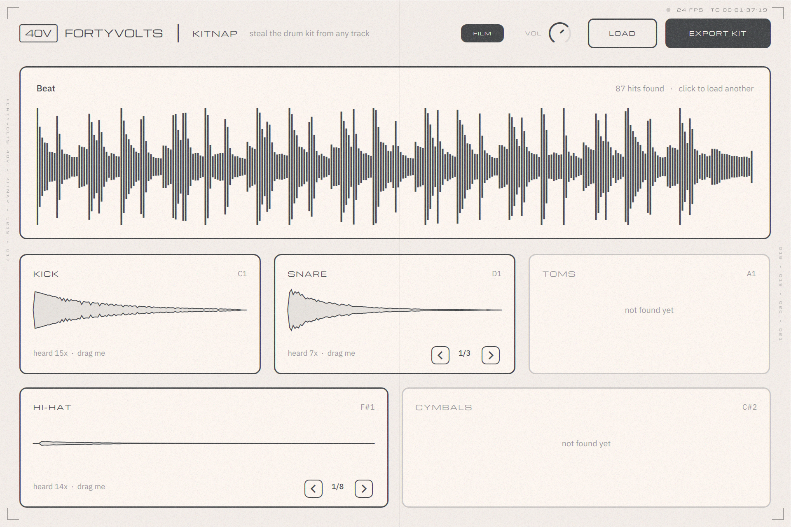

# KITNAP

**Steal the drum kit from any track.**



Drop a song into KITNAP and two AI models take the drums apart: the first pulls the drums out of the mix, the second splits them into kick, snare, toms, hi-hat and cymbals. Those become four pads (the hi-hats and cymbals share one), with single hits cut straight out of their part, exactly as they sound in the record. Play the kit with MIDI, flip through variations, drag any sound straight into your DAW, or export the whole kit as WAVs.

Runs as VST3 (any DAW), AU (Logic, GarageBand) and as a standalone app.

## Using it

1. Put KITNAP on an instrument track.
2. Drop an audio file on the song card at the top, or click it to browse. WAV, AIFF, FLAC, MP3 and OGG all work.
3. Watch the drums get kidnapped: the waveform fills with colour while the AI separates the drums from the rest of the song, splits them into kick, snare, toms, hi-hat and cymbals, and cuts out the sounds. A full song takes a few minutes; the kit is saved with your project, so this only happens once.
4. Click a pad to hear it. Use ‹ › to flip through variations, for example when a track has two different snares, or on the cymbals pad its closed and open hi-hat, crash and ride. Each pad shows how many of the hits the AI heard sound like its current sound.
5. Drag a pad onto a track or into your sampler to get the WAV, or press **Export kit** for a folder with all of them.

When the kit is ready the song's waveform glows in a slowly flowing colour gradient, and a pad's tile lights up in it while its sound plays.

MIDI uses the General MIDI drum map, so any drum pattern plays it straight away:

| Pad      | Notes |
|----------|-------|
| Kick     | C1 (36), B0 (35) |
| Snare    | D1 (38), and 37, 39, 40 |
| Toms     | A1 (45), and 41, 43, 47, 48, 50 |
| Cymbals  | F#1 (42), and the hi-hats 44, 46 and cymbals 49, 51, 52, 53, 55, 57, 59 |

The whole kit (every variation, the hit map and the waveform) is saved inside your project, so reopening a session is instant and still works if you move or delete the source file.

## How it works

KITNAP only uses what the two models give it. Nothing is classified, filtered, averaged or generated afterwards.

0. **Pick the sections with drums.** A kit needs one clean hit of each sound, and drum sounds repeat, so the AI doesn't have to hear the whole song. A quick scan (no AI) measures how many sudden attacks every stretch of the song has; the song is divided into five parts, and from each the 12 seconds with the most drum hits are taken (a part far quieter in hits than the busiest, like an intro without drums, is skipped). That's at most a minute of audio, joined with half a second of silence between the sections, so a 4-minute song takes about a quarter of the time. The editor doesn't show which sections were picked: its scanner sweeps evenly through the whole song. Songs under 75 seconds are used whole.

1. **Separate the drums (AI).** ZFTurbo's 4-stem BS-RoFormer, a band-split transformer model, run with ONNX Runtime, removes everything that isn't drums. The song is processed in 4-second chunks that are cross-faded over half a second. (The model was trained on 11-second chunks, but its memory use grows with the square of the chunk length.)
2. **Split the kit (AI).** A second model, KITNAP's own (MDX23C, trained in `training/drumsplit`), splits the drum stem into kick, snare, toms, hi-hat and cymbals, in 6-second chunks that overlap by half and are cross-faded. These five parts make the four pads: whatever the model puts in the snare part ends up on the snare pad, and so on; the hi-hat and cymbals parts both go on the cymbals pad.
3. **Find the hits in each part.** Spectral-flux onset detection, then each hit is pinned to where its attack rises most above what was sounding just before. Whatever the split leaves of other drums in a part is far quieter than the part's own hits, so only hits within 30 dB of the part's loud ones count (and a part that is more than 35 dB below the loudest one, like the toms part of a song without toms, stays empty).
4. **Group the hits that sound alike.** Every hit gets a fingerprint: its level in 24 frequency bands over its first 80 ms, minus whatever was still ringing from before it, relative to its own loudest band. Hits are grouped step by step, always merging the two groups that are closest on average, until the closest two are clearly further apart than hits of the same drum usually are in that part (a programmed sample barely changes, a live drummer does). So in a song whose beat switches (Sicko Mode), each beat's kick and snare stays its own sound. Each group is a variation on the pad, the most frequent first. A sound that occurs only once (or in under 2% of the part's hits) is left out.
5. **Pick the cleanest hit and cut it out.** Per group, among the loud hits, the one with the most room to ring out before the part's next hit and the least of the previous hit underneath it. It's cut straight out of the part, from 2 ms before the hit to where it has died away (45 dB down) or the next hit starts, with only a 2 ms fade-in and a 5 ms fade-out so it doesn't click. No level change. If its last 50 ms swell up again, that's the next hit's lead-in (the models smear every hit back in time by up to 46 ms), so it ends where it was quietest instead.

### What to expect

- A sound that only occurs outside the picked sections (a crash only at the very start, say) isn't in the kit.
- How clean a pad sounds is down to the two models: what's left of other drums in a part (a hat under the snare, say) stays in its sound, and a drum the model puts in the wrong part ends up on the wrong pad.
- Each sound is a single hit from the song, so it carries what was playing at that moment in its part. When the next hit of the same part comes quickly (fast hats), the sound is that short.
- **On a Mac the AI can run on the GPU** (through Core ML, in 32-bit floats like on the CPU). The first time, KITNAP prepares each model for the GPU and times one chunk on the GPU and one on the CPU, then remembers which is faster on that Mac (in `~/Library/Caches/KITNAP`, together with the prepared models), so the first track takes a minute or two longer. If the GPU can't be used, KITNAP quietly runs everything on the CPU instead.
- On the CPU (Windows and Linux, or a Mac without Core ML) the AI steps take a few minutes for a full song: on 4 cores about 2.2 times the song's length to separate, plus about 1.1 times to split; faster with more cores. They run on one thread per performance core (Apple Silicon's efficiency cores would only hold the others up), and need about 3 GB of memory while separating.

> Sounds pulled from commercial songs are fine for practice and personal use, but clear samples before releasing music with them.

## Getting the plugin

Download the installer for your system from the repository's **Releases** page:

- **Windows:** `KITNAP-x.y.z-Windows-Setup.exe` installs the VST3 plugin (into `C:\Program Files\Common Files\VST3`, where FL Studio, Ableton and other DAWs look) and the standalone app, plus the AI drum split model, and adds an uninstaller.
- **macOS:** `KITNAP-x.y.z-macOS.pkg` installs the VST3, the Audio Unit (Logic, GarageBand), the standalone app and the AI drum split model. Click *Customize* to choose.
- **Linux:** unpack `KITNAP-x.y.z-Linux.tar.gz` and run `./install.sh` (installs to `~/.vst3`, `~/.lv2`, `~/.local/bin` and `~/.config/KITNAP`).

Then rescan plugins in your DAW. In FL Studio: *Options → Manage plugins → Find installed plugins*, then add KITNAP from the Channel rack.

The installers aren't code-signed yet, so the first launch shows a warning:
- **Windows** (SmartScreen): click *More info → Run anyway*.
- **macOS:** if the installer is blocked, open *System Settings → Privacy & Security* and click *Open Anyway* (on older macOS, right-click the `.pkg` and choose *Open*).

Every push builds the Mac installer and plugins (Windows and Linux are switched off in `.github/workflows/build.yml` to save GitHub Actions minutes; uncomment them there to build those installers too); they're under *Artifacts* on each run in the **Actions** tab (GitHub login required, kept for 90 days). Pushing a version tag (`git tag v0.2.0 && git push origin v0.2.0`) publishes a Release with the three installers attached.

### The AI files

The models (`kitnap_drums_4stem.onnx`, 236 MB, and `kitnap_drumsep5.onnx`, 247 MB) and ONNX Runtime are installed once in a shared folder that the plugins and the app all use: `C:\ProgramData\KITNAP` on Windows, `/Library/Application Support/KITNAP` on macOS, `~/.config/KITNAP` on Linux. (A runtime inside the plugin, in `Contents/Resources` or `Resources/` next to the binary, is used first; self-built plugins have one there.) KITNAP loads the runtime only when needed and never links against it. The separation model is exported with its attention, normalisation and rotary embeddings written out as plain matrix and element-wise operations (the same math), which runs about a third faster on the CPU and lets Core ML take on the whole model. Both models are needed to make a kit: if a file is missing or can't load (e.g. on a very old macOS), loading a track shows why, and kits saved in a project still open and play.

The models:
- **Separation:** ZFTurbo's 4-stem BS-RoFormer (bass, drums, vocals, other), from his [Music-Source-Separation-Training](https://github.com/ZFTurbo/Music-Source-Separation-Training) releases (MIT, checksum verified), converted by `tools/export_drums.py`, drums only. Input and output `[1, 2, 1025, 401, 2]` (channel, bin, frame, real/imaginary; 2048-point FFT, hop 441).
- **Drum split:** KITNAP's own model (MDX23C, 62M parameters), trained with `training/drumsplit` only on material that may be used commercially (see [its README](training/drumsplit/README.md#data-and-licences)). It's downloaded as ONNX from this repository's [`drumsplit-v1` release](https://github.com/TjerkieWisse/NewPlugin/releases/tag/drumsplit-v1) (checksum verified); `training/drumsplit/export.py` makes it from a training run. Input `[1, 4, 1024, 512]` (2048-point FFT, hop 512), output `[1, 5, 4, 1024, 512]`: kick, snare, toms, hi-hat, cymbals.

**Licences and credits.** ZFTurbo's code and weights are MIT: KITNAP must include his copyright and licence notice. His model was trained on MUSDB18-HQ, whose licence is for non-commercial research; whether that affects a model trained on it is a question for a lawyer before selling. The drum split model's training data needs credit in KITNAP: the Groove MIDI Dataset (Google Magenta) and StemGMD (Politecnico di Milano), both CC BY 4.0.

## Building it yourself

You need CMake 3.22+ and a C++17 compiler (Xcode on macOS, Visual Studio 2022 on Windows). JUCE is downloaded automatically.

```bash
cmake -S . -B build -DCMAKE_BUILD_TYPE=Release
cmake --build build --config Release --parallel
```

The plugins end up in `build/KITNAP_artefacts/Release/`. The build downloads ONNX Runtime 1.23.2 and the models (checksums verified), copies the runtime into each plugin, and converts the separation model to ONNX, which needs Python with PyTorch (`pip install torch onnx onnxruntime numpy BS-RoFormer==0.4.1`); without it the build continues without it. The models land in `build/kitnap-ai/`: copy them into the shared folder above to use them with a self-built plugin. Pass `-DKITNAP_WITH_AI=OFF` to build without any AI, `-DKITNAP_WITH_DRUM_SPLIT=OFF` to skip downloading the split model, or `-DKITNAP_DRUMSEP_ONNX=<file>` to use another one (such as a newer training run's).

### Tests

`KitnapAnalyzerTest` builds five synthetic drum parts (two different kicks, a snare, a tom fill, hats and a crash, with a faint copy of the snare in the kick part like the bleed the split leaves), extracts the kit, and checks that every hit is found at the right place and nothing else, that each drum ends up on its own pad (two kicks and two toms as variations, the hats and the crash on the cymbals pad, hats first), and that every sound is a hit of its part, unchanged apart from the fades. It also builds a 3-minute song with and without drums and checks the section picker only picks stretches with drums, from both of them.

```bash
./build/KitnapAnalyzerTest_artefacts/Release/KitnapAnalyzerTest            # run the test
./build/KitnapAnalyzerTest_artefacts/Release/KitnapAnalyzerTest kit-out    # ...and write the extracted kit as WAVs
./build/KitnapAnalyzerTest_artefacts/Release/KitnapAnalyzerTest --file-ai song.mp3 kit-out   # the plugin's pipeline
./build/KitnapAnalyzerTest_artefacts/Release/KitnapAnalyzerTest --file-ai-full song.mp3 kit-out   # the same on the whole song
./build/KitnapAnalyzerTest_artefacts/Release/KitnapAnalyzerTest --sections song.mp3          # which sections the AI would process
./build/KitnapAnalyzerTest_artefacts/Release/KitnapAnalyzerTest --separate song.mp3 drums.wav   # write the AI drum stem
./build/KitnapAnalyzerTest_artefacts/Release/KitnapAnalyzerTest --split drums.wav parts      # write its five parts (kick, snare, toms, hi-hat, cymbals)
./build/KitnapAnalyzerTest_artefacts/Release/KitnapAnalyzerTest --file-parts parts kit-out   # only the last step, from those parts
./build/KitnapAnalyzerTest_artefacts/Release/KitnapAnalyzerTest --hits parts                 # list the hits found in each part
./build/KitnapAnalyzerTest_artefacts/Release/KitnapAnalyzerTest --write-mix beat.wav         # the synthetic drums with bass and chords, for trying the AI
./build/KitnapAnalyzerTest_artefacts/Release/KitnapAnalyzerTest --compare a.wav b.wav -40     # how far apart two stems are (fails above -40 dB)
```

On a Mac, `KITNAP_CPU_ONLY=1` runs the models on the CPU, `KITNAP_FORCE_GPU=1` on the GPU (without timing which is faster), and `KITNAP_ORT_LOG=1` shows ONNX Runtime's details (such as how much of each model Core ML takes on). CI separates and splits a few seconds of the synthetic beat both ways and checks the results match (GitHub's Mac runners have no real GPU, so there Core ML is slow and KITNAP picks the CPU by itself).

On Linux, `-DKITNAP_BUILD_SCREENSHOT=ON` also builds `KitnapScreenshot`, which renders the UI to PNGs (run it under `xvfb-run`).

## Project layout

```
Source/
  analysis/DrumAnalyzer.*   finds the hits in each part, groups them, cuts out the sounds
  separation/DrumSeparator.* AI drum separation and drum split (ONNX Runtime, loaded at run time)
  engine/KitSampler.*       the 4-pad sampler (MIDI, voice handling)
  ui/                       the song card/drop zone, pad tiles, the FortyVolts theme (fonts, colours, logo)
  PluginProcessor.*         loading, background analysis, saving with the project, export
  PluginEditor.*            the window
Resources/                  fonts (Michroma, Geist, Geist Mono; SIL Open Font License) and the FortyVolts logo
tests/                      analyzer test and screenshot tool
installer/                  Windows (Inno Setup), macOS (pkg) and Linux installers
cmake/KitnapAI.cmake        downloads ONNX Runtime + models, converts the separation model, bundles the runtime
tools/export_drums.py       converts ZFTurbo's 4-stem BS-RoFormer checkpoint to ONNX (drums only)
tools/export_drumsep.py     the drum split network (MDX23C) and its ONNX export, used by training/drumsplit
training/drumsplit/         trains KITNAP's own drum split model (see its README)
```

## License note

KITNAP is built with [JUCE](https://juce.com). JUCE is dual-licensed: AGPLv3, or a commercial JUCE licence (including a free tier for small developers). Check the current terms at juce.com before selling KITNAP or releasing it closed-source.
