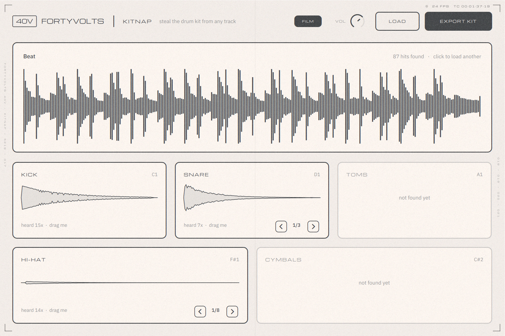

# KITNAP

**Steal the drum kit from any track.**



Drop a song or drum loop into KITNAP and it uses AI to pull the drums out of the mix, finds every drum hit, sorts them into kick, snare, clap, hat, open hat and perc, and turns each one into a clean, playable sample. Play the kit with MIDI, flip through variations, drag any sound straight into your DAW, or export the whole kit as WAVs.

Runs as VST3 (any DAW), AU (Logic, GarageBand) and as a standalone app.

## Using it

1. Put KITNAP on an instrument track.
2. Drop an audio file on the big strip at the top, or click it to browse. WAV, AIFF, FLAC, MP3 and OGG all work.
3. Watch the drums get kidnapped. First the AI separates the drums from the rest of the song (violet scanner, about a minute for a full song), then every hit lights up in its drum's colour along the waveform.
4. Click a pad to hear it. Use ◀ ▶ to flip through variations, for example when a track has two different snares.
5. Drag a pad onto a track or into your sampler to get the WAV, or press **EXPORT KIT** for a folder with all of them.

MIDI uses the General MIDI drum map, so any drum pattern plays it straight away:

| Pad      | Note |
|----------|------|
| Kick     | C1 (36) |
| Snare    | D1 (38) |
| Clap     | D#1 (39) |
| Hat      | F#1 (42) — chokes the open hat |
| Open hat | A#1 (46) |
| Perc     | A1 (45) |

The **AI** switch turns drum separation on or off. Switching it re-runs the current track, so you can compare both versions. With it off, KITNAP analyses the full mix directly: much faster, and fine for drum loops and stems.

The whole kit (every variation, the hit map and the waveform) is saved inside your project, so reopening a session is instant and still works if you move or delete the source file.

## How it works

0. **Separate the drums (AI).** An MDX-Net drum separation model, run on the CPU with ONNX Runtime, removes everything that isn't drums. The song is processed in 12-second chunks with overlapping edges so chunk borders never land in the output.
1. **Find the hits.** Spectral-flux onset detection, then each hit is pinned to the sample by looking for the sharpest energy rise in three frequency bands. That way a quiet hat over a loud bass line is still placed exactly.
2. **Name them.** For every hit it measures the energy the hit *adds* compared with just before it (so bass and chords ringing underneath are ignored): low end, mids, top, noisiness, how long the top end rings, and whether there are several quick bursts (a clap). A kick and a hat landing together counts as both.
3. **Group them.** Hits of the same drum are compared waveform-to-waveform and grouped, so a song with two different snares gives you two variations.
4. **Peel off layers.** Hits where two drums land together (snare + open hat, kick + hat) are detected; each sound is preferably built only from hits where its drum plays alone. If a drum only ever occurs layered, the other drum's clean copy is checked against it by its spectral "fingerprint" (the exact pattern of peaks and dips of that sample) and, if present, its waveform is lined up to the sample and subtracted.
5. **Stack them.** Every hit in a group is aligned to the sample and averaged. The drum is identical every time, but the music around it isn't, so averaging cancels out much of the rest of the song. This is where the clean sound comes from: the more often a drum repeats, the cleaner it gets.
6. **Let it ring.** In a busy groove the next drum usually comes within 1/16 or 1/8, which used to chop sounds short. Now: drums that follow at the same distance every time are subtracted from the tail when they cancel cleanly; the real tail is grafted on from hits of the same drum that have room to ring out (e.g. before a break); and noisy drums (snare, clap, hats) that still had to be cut are continued with noise shaped like their own last moments, decaying at their own rate.
7. **Clean up.** Each drum type gets its own filters (the kick's tail is low-passed to remove hats, hats are high-passed to remove the kick and bass), then the sound is trimmed where it dies away or where a new hit starts (judged above 300 Hz, so a deep kick's wobble isn't mistaken for one), faded and normalised.

### What to expect

- **Full songs** come out clean thanks to the AI separation, even sample-based tracks where the music loops behind every drum hit.
- **Drum loops, drum stems and beats with clear drums** come out very clean with the AI on or off.
- The separation takes roughly 15 to 25 seconds per minute of audio on a typical laptop CPU.
- **Layered drums** (a snare with an open hat on top, a kick with a hat) get separated: KITNAP builds each sound from the hits where that drum plays alone, and if a drum is *always* layered, it subtracts a clean copy of the other drum (taken from elsewhere in the track) sample-accurately. When the other drum never plays alone (e.g. an open hat that only ever lands on the clap), KITNAP models the top end as two decays: the clap's own, which fades with its body, and the slower ring of the hat. Once the clap's body has died away it fits the hat's ring, extends it back to the start and removes it, so the sizzle that keeps going after the clap is gone. The very start of the hat stays, since it lands on (and is masked by) the clap's attack. Sounds that are layered by design (a snare and clap stacked into one sample) stay as you hear them.

> Sounds pulled from commercial songs are fine for practice and personal use, but clear samples before releasing music with them.

## Getting the plugin

Download the installer for your system from the repository's **Releases** page:

- **Windows:** `KITNAP-x.y.z-Windows-Setup.exe` installs the VST3 plugin (into `C:\Program Files\Common Files\VST3`, where FL Studio, Ableton and other DAWs look) and the standalone app, and adds an uninstaller.
- **macOS:** `KITNAP-x.y.z-macOS.pkg` installs the VST3, the Audio Unit (Logic, GarageBand) and the standalone app. Click *Customize* to choose.
- **Linux:** unpack `KITNAP-x.y.z-Linux.tar.gz` and run `./install.sh` (installs to `~/.vst3`, `~/.lv2` and `~/.local/bin`).

Then rescan plugins in your DAW. In FL Studio: *Options → Manage plugins → Find installed plugins*, then add KITNAP from the Channel rack.

The installers aren't code-signed yet, so the first launch shows a warning:
- **Windows** (SmartScreen): click *More info → Run anyway*.
- **macOS:** if the installer is blocked, open *System Settings → Privacy & Security* and click *Open Anyway* (on older macOS, right-click the `.pkg` and choose *Open*).

Every push also builds the installers and raw plugins; they're under *Artifacts* on each run in the **Actions** tab (GitHub login required, kept for 90 days). Pushing a version tag (`git tag v0.2.0 && git push origin v0.2.0`) publishes a Release with the three installers attached.

### The AI files

ONNX Runtime and the model ship inside the plugin (`Contents/Resources` in the bundle, or `Resources/` next to the binary). KITNAP loads the runtime only when needed and never links against it, so if the files are missing or can't load (e.g. on a very old macOS), the AI switch shows **N/A** and everything else keeps working. You can also put `kitnap_drums.onnx` and the ONNX Runtime library in your user application data folder under `KITNAP`.

The bundled model is the MDX-Net drums model by KUIELab (Music Demixing Challenge 2021), as distributed by the UVR project. **Before selling KITNAP, check this model's licence and training data** (MUSDB18-HQ, which is licensed for non-commercial use), or swap in a model with a commercial licence. Any MDX-Net-style model with a `[batch, 4, freq, time]` input, a 4096-point FFT and a hop of 1024 works as a drop-in `kitnap_drums.onnx`.

## Building it yourself

You need CMake 3.22+ and a C++17 compiler (Xcode on macOS, Visual Studio 2022 on Windows). JUCE is downloaded automatically.

```bash
cmake -S . -B build -DCMAKE_BUILD_TYPE=Release
cmake --build build --config Release --parallel
```

The plugins end up in `build/KITNAP_artefacts/Release/`. The build downloads ONNX Runtime 1.20.1 and the model (checksums verified) and copies them into each plugin. Pass `-DKITNAP_WITH_AI=OFF` to build without them.

### Tests

`KitnapAnalyzerTest` builds a synthetic beat (kick, snare, clap, hats, open hat) with a bass line and chords on top, runs the analyzer, and checks that every drum is detected, classified and extracted cleanly (each extracted sound must match the original with a correlation of 0.8 or higher; currently 0.97–1.0). `--layered` runs the same with every snare layered with an open hat and the kicks layered with hats; there the other drum must be at least 20 dB down in every extracted sound (currently 30–49 dB). `--layered-always` makes the open hat play only together with the snare (no clean copy exists), and checks the hat ringing on in the snare's tail.

```bash
./build/KitnapAnalyzerTest_artefacts/Release/KitnapAnalyzerTest            # run the test
./build/KitnapAnalyzerTest_artefacts/Release/KitnapAnalyzerTest kit-out    # ...and write the extracted kit as WAVs
./build/KitnapAnalyzerTest_artefacts/Release/KitnapAnalyzerTest --file song.wav kit-out   # analyse your own file
./build/KitnapAnalyzerTest_artefacts/Release/KitnapAnalyzerTest --separate song.mp3 drums.wav   # write the AI drum stem
```

On Linux, `-DKITNAP_BUILD_SCREENSHOT=ON` also builds `KitnapScreenshot`, which renders the UI to PNGs (run it under `xvfb-run`).

## Project layout

```
Source/
  analysis/DrumAnalyzer.*   onset detection, classification, grouping, stacking, cleanup
  separation/DrumSeparator.* AI drum separation (ONNX Runtime, loaded at run time)
  engine/KitSampler.*       the 6-pad sampler (MIDI, choke, voice handling)
  ui/                       waveform/drop zone, pads, colours
  PluginProcessor.*         loading, background analysis, saving with the project, export
  PluginEditor.*            the window
tests/                      analyzer test and screenshot tool
installer/                  Windows (Inno Setup), macOS (pkg) and Linux installers
cmake/KitnapAI.cmake        downloads ONNX Runtime + model and bundles them
```

## License note

KITNAP is built with [JUCE](https://juce.com). JUCE is dual-licensed: AGPLv3, or a commercial JUCE licence (including a free tier for small developers). Check the current terms at juce.com before selling KITNAP or releasing it closed-source.
